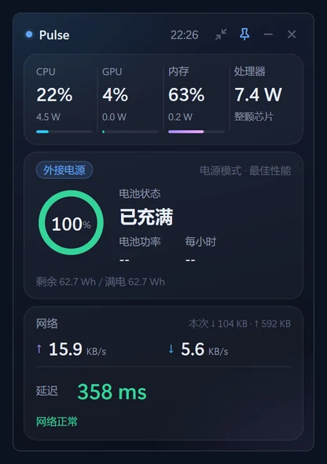

# Pulse

**English** | [简体中文](README.md)

Pulse is a floating desktop widget for Windows. A single statically linked `Pulse.exe`, built with native C++17, Win32, and Direct2D, displays hardware, battery, and network status.

The app UI is currently available in Simplified Chinese only.

[Download the latest release](https://github.com/yftx888/Pulse/releases/latest) · Windows 10 / 11, 64-bit · No installation required

<p align="center"></p>
<p align="center"></p>

## Features

By default, Full mode (完整模式) shows the following from top to bottom:

- Hardware panel (硬件四格): four tiles showing CPU, GPU (3D engine), and memory usage and power, plus Processor (处理器) power for the entire processor package. Memory power comes from RAPL DRAM.
- Battery and charging (电池与充电): charging or discharging power, smoothed estimates of remaining runtime or time to full charge, time to reach 20%, and average power since unplugging. If Pulse starts while on battery, the average is measured from startup.
- Network (网络): upload and download speeds for physical network adapters only, with prominent HTTP latency and offline status.
- Top three processes (进程前三) by CPU usage, excluding Pulse itself. Pulse's own usage is shown separately.

Mini mode (迷你模式) is a single line that can show battery level, remaining runtime or time to full charge, a charging lightning indicator, and an external-power indicator. Its Total power (总功耗) component and Full mode's Power history (功耗走势图) show battery discharge power under the label Whole system (整机) while discharging. In all other power states, they show processor package power under the label Processor. The fourth hardware tile is always labeled Processor.

Right-click the window or tray icon and open Show content (显示内容) to choose components separately for each mode:

| Mode | Available components |
| --- | --- |
| Full mode | Hardware panel, Battery and charging, Power history, Network, Top three processes, Disk read/write speed (磁盘读写速度), System drive usage (系统盘占用), System information (系统信息), GPU memory (显存), Wi-Fi, Battery health (电池健康), Frame rate (帧数) |
| Mini mode | Battery % (电量 %), Runtime/time to full (续航/充满), Total power, CPU %, Memory % (内存 %), GPU %, Network speed (网速), Latency (延迟), Disk read/write (磁盘读写), CPU frequency (CPU 频率), FPS |

Optional metrics are collected only while their components are enabled; disabling them stops collection. Basic sampling for CPU, memory, battery, and network speed, along with network probes, remains active. System information includes CPU frequency, used/total memory, process count, and uptime.

Other features:

- Foreground app frame rate (FPS), measured through ETW DXGI/D3D9 Present events, requires administrator privileges. If frame rate is enabled without sufficient privileges, the menu offers Restart as administrator for frame rate (以管理员身份重启（显示帧数需要）). Some apps may not expose a readable frame rate.
- Full mode refreshes every 0.5 / 1 / 2 seconds, with a default of 1 second. Mini mode refreshes about every 2 seconds.
- The slow-latency threshold can be set to 50 / 100 / 150 / 200 / 300 / 500 / 800 ms, with a default of 500 ms.
- Offline and recovery notification cards fade out after about 8 seconds. Hovering pauses the timer; moving away starts a roughly 3-second timer before they fade out. Notifications and sounds have separate switches. Sleep does not count as an outage.
- Interface scaling from 80% to 200%, also adjustable with Ctrl + mouse wheel.
- Dark context menus, a tray icon, Always on top (窗口置顶), Start with Windows (开机自启), and Restore defaults (恢复默认) for component selections.

## Screenshots

Full mode:


Mini mode:


## System requirements

- Windows 10 or Windows 11, 64-bit.
- Runs as a standard user. Only the frame-rate feature requires administrator privileges.
- Hardware power comes from Energy Meter (RAPL) performance counters, without administrator privileges. Full mode prefers differences between `\Energy Meter(*)\Energy` samples and falls back to `\Energy Meter(*)\Power` if unavailable. Mini mode reads Power directly.
- If the counters or the relevant instances are missing, the corresponding power values appear as unknown (`--`). Memory power requires a DRAM instance. Battery charging and discharging power comes from the Windows battery interface.

## Installation

Download and extract the zip, then run `scripts\install.cmd`. The script:

1. Exits Pulse if it is running.
2. Copies `Pulse.exe` to `%LOCALAPPDATA%\Pulse`.
3. Creates a Start menu shortcut for the current user.
4. Uses the options below to determine whether to create a desktop shortcut and enable startup with Windows.
5. Starts the installed copy of Pulse.

Installation and normal use do not require administrator privileges; the frame-rate feature does. You can also run `Pulse.exe` directly after extraction. Settings are still saved in `%LOCALAPPDATA%\Pulse`.

`install.ps1` looks for `Pulse.exe` in the script's directory and its parent. When installing from this repository, build `Pulse.exe` in the repository root first.

| Option | Effect |
| --- | --- |
| (No options) | Asks whether to create a desktop shortcut and start with Windows |
| `-Desktop` | Creates a desktop shortcut without prompting |
| `-Autostart` | Enables startup with Windows without prompting |
| `-Quiet` | Suppresses prompts; options not explicitly specified are not enabled |

Examples:

```bat
scripts\install.cmd
scripts\install.cmd -Desktop -Autostart
scripts\install.cmd -Quiet
```

Startup uses the current user's `HKCU\Software\Microsoft\Windows\CurrentVersion\Run` key, with a value named `Pulse` containing the full, quoted path to `Pulse.exe`. This is the same entry controlled by Start with Windows in the app menu. The menu writes the path of the currently running copy; the installer writes `%LOCALAPPDATA%\Pulse\Pulse.exe`.

## Uninstallation

Run `scripts\uninstall.cmd`. The script exits only Pulse processes identified as this app by window class or version information, skipping other programs with the same name. It removes the Run value described above and removes Start menu and desktop `Pulse.lnk` shortcuts that target `Pulse.exe` or have no target.

Window position, mode, Always on top, component selections, refresh interval, interface size, slow-latency threshold, offline notifications, and sound settings are saved in `%LOCALAPPDATA%\Pulse\settings.ini`. Logs for network probes, frame-rate diagnostics, and other events are stored in `%LOCALAPPDATA%\Pulse\pulse_net.log`, in the same folder as the installed app. No settings are written to `%APPDATA%` (the roaming directory), but the uninstaller still checks it for settings and logs with the same names.

If these files exist, the script asks whether to remove them. Choosing Y deletes the entire `%LOCALAPPDATA%\Pulse` directory and any detected settings and log files in the roaming directory. Choosing N removes only `Pulse.exe` and the shortcuts, keeping settings and logs. If no settings or logs are found, the installation directory is removed by default.

| Option | Effect |
| --- | --- |
| (No options) | Asks whether to delete settings and logs if they exist |
| `-KeepConfig` | Keeps settings and logs without prompting |
| `-RemoveConfig` | Deletes settings, logs, and the installation directory without prompting |

## Usage

- Drag an empty area of the window to move it. Its position is saved.
- Double-click an empty area, or click the mode button, to switch between Full and Mini modes.
- The pin button toggles Always on top, which is enabled by default.
- Minimizing pauses sampling for the UI. Left-click the tray icon to hide or show the window. Hiding also pauses UI sampling, while network probes continue. Sampling resumes when the window is shown again.
- The close button exits the app.
- Hold Ctrl and scroll inside the window to change the scale by 10 percentage points per notch, between 80% and 200%. Use the mouse wheel without Ctrl to scroll content that extends beyond the screen.

The window and tray icon share this context menu:

| Menu item | Effect |
| --- | --- |
| Full mode / Mini mode | Switches display mode |
| Interface size (界面大小) | 80% / 100% (default) / 125% / 150% / 175% / 200% |
| Refresh interval (刷新间隔) | Sets Full mode's refresh interval to 0.5 / 1 (default) / 2 seconds |
| Slow-latency threshold (延迟较慢阈值) | 50 / 100 / 150 / 200 / 300 / 500 (default) / 800 ms |
| Offline notifications (断网提醒) | Toggles offline and recovery cards; enabled by default |
| Notification sound (提醒提示音) | Toggles sound separately; enabled by default and unavailable when offline notifications are disabled |
| Show content → Full mode / Mini mode | Selects components for each mode |
| Show content → Restore defaults | Resets only the default component selections for both modes |
| Always on top | Toggles pinning the window above others |
| Start with Windows | Toggles startup for the current user |
| Open log (打开日志) | Opens the local log |
| Restart as administrator for frame rate | Appears when frame rate is enabled in the current mode and administrator privileges are missing |
| Exit (退出) | Exits the app |

## Network latency

Latency is measured with WinHTTP HTTP requests through the system proxy, rather than ICMP ping. In some proxy or TUN configurations, ping results may not reflect actual access latency. The probe addresses are:

- `http://www.msftconnecttest.com/connecttest.txt`
- `http://www.gstatic.com/generate_204`
- `http://connect.rom.miui.com/generate_204`

Under normal conditions, Pulse probes the first address about every 5 seconds. If it fails, Pulse tries the two fallback addresses in parallel. After an unavailable result or a network-adapter change, it probes all three in parallel and uses the first response headers received. It does not check response bodies or follow redirects. Latency is timed from the start of the current probe stage; fallback latency excludes the time spent waiting for the primary address to fail.

| Result | Interpretation |
| --- | --- |
| Request succeeds with latency < selected threshold | Normal |
| Latency ≥ selected threshold (default 500 ms) and < 1000 ms | Slow |
| Probe round fails, or latency ≥ 1000 ms | Counts as one unavailable result |
| 3 consecutive unavailable results | Connection is marked offline |
| One successful request with latency < 1000 ms | Clears the failure count; restores an offline connection |
| All physical network adapters are disconnected, confirmed after a short debounce | Connection is marked offline immediately, without waiting for 3 unavailable HTTP results |

After an unavailable result, Pulse checks about every 1 second; once offline, it retries about every 1.5 seconds. After physical adapters disconnect, the physical connection must return before Pulse can mark the connection as restored, even if a local proxy returns a successful response. System sleep pauses probing and clears outage timing. Probing resumes about 3 seconds after wake.

## Building from source

Install 64-bit MinGW-w64 g++ 13.2, including `windres`, and add it to PATH. From the repository root, run:

```bat
build.bat
```

In PowerShell:

```powershell
& .\build.bat
```

The script produces the statically linked `Pulse.exe` and the console self-test program `metrics_selftest.exe`. The source uses C++17 and can also be built with MSVC: run `build_msvc.bat` from an x64 Developer Command Prompt. Its output goes to `build-msvc\`. Release builds use MinGW.

To package a zip (runs `build.bat` first):

```bat
scripts\package.cmd
scripts\package.cmd -NoBuild
scripts\package.cmd -Version 1.0.0
```

`-NoBuild` skips compilation only if `Pulse.exe` already exists in the repository root. Without `-Version`, the script reads `FileVersion` from `app.rc`, falling back to `0.1.0` if it cannot be read. The output is `dist\Pulse-<version>-win-x64.zip`, containing `Pulse.exe`, `README.md`, `LICENSE`, `THIRD_PARTY_NOTICES.md`, and the installation and uninstallation scripts from `scripts\`.

GitHub Actions automatically builds and publishes a Release when a `v*` tag is pushed.

## Resource usage

The following CPU-usage figures were measured on an Intel Core Ultra 5 226V laptop running on battery. They use Pulse's process CPU time, expressed as a percentage of one CPU core:

| Mode | CPU usage |
| --- | --- |
| Mini mode | About 0.1%–0.3% of one core |
| Full mode | Runs the full collection path on each refresh; about 0.5%–1.5% of one core |

Optional metrics still depend on component selections and their individual collection intervals. These figures vary with hardware, enabled components, refresh interval, and background load, and are for reference only.

## Acknowledgments

See [THIRD_PARTY_NOTICES.md](THIRD_PARTY_NOTICES.md).

## Disclaimer and privacy

- This software is provided "as is", without warranty. You use it at your own risk, and the author is not liable for losses caused by its use. See [LICENSE](LICENSE) (MIT) for the governing terms.
- Pulse reads system performance counters, battery information, processes, and network status. It changes system settings only when you choose Start with Windows. In a normal environment, runtime settings and logs are written only to `%LOCALAPPDATA%\Pulse`. Toggling Start with Windows writes or deletes the `Pulse` value under `HKCU\Software\Microsoft\Windows\CurrentVersion\Run`. The installer also copies the app and creates the shortcuts described above.
- Network access is used only for latency measurement, by periodically requesting the three probe addresses listed above through the system proxy. Pulse does not collect or upload personal data over the network and has no analytics, telemetry, or automatic updates.
- Logs are stored locally and are never uploaded.
- Administrator privileges are used only for the frame-rate feature's ETW session. They are unnecessary if you do not need frame rate.
- `Pulse.exe` is not code-signed, so Windows SmartScreen may warn on first launch. You can select More info → Run anyway. Download only from this project's GitHub Releases.

## License

[MIT License](LICENSE). Copyright © 2026 yftx.
