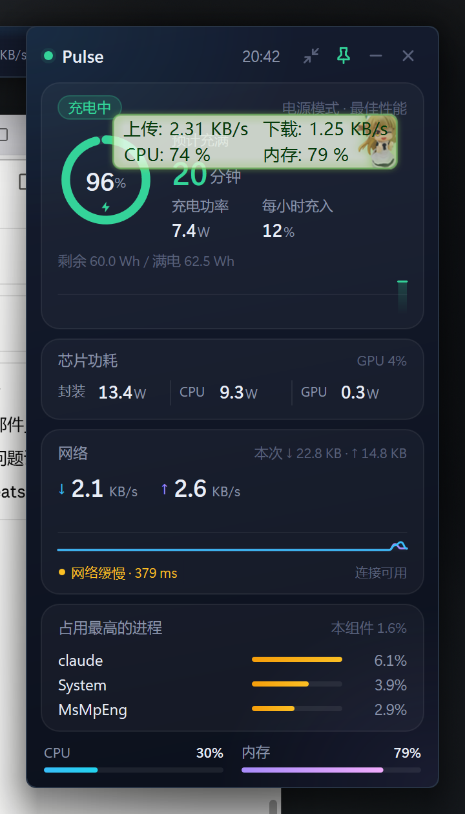

# Pulse

Pulse 是 Windows 桌面悬浮小组件：一个静态链接的 `Pulse.exe`，用原生 C++17、Win32 和 Direct2D 显示电池、功耗与网络状态。

## 功能

- 电池充放电功率
- 平滑续航预计（到 20% 的时间、拔电后的平均功耗）
- 芯片、CPU、核显功耗
- 网速（只统计物理网卡）
- 真实网络延迟与断网判定
- 断网与恢复提醒卡片
- 进程 CPU 占用前三
- CPU 与内存占用
- 完整模式与迷你单行模式
- 托盘图标
- 开机自启

## 截图



## 系统要求

- Windows 10 或 Windows 11，64 位
- 普通用户权限即可运行，不需要管理员
- 芯片、CPU、核显功耗来自性能计数器 `\Energy Meter(*)\Power`（RAPL）。机器没有这组计数器时，这几项显示为未知，其余功能仍可用

## 安装

下载 zip 并解压后，运行 `scripts\install.cmd`。脚本会：

1. 若 Pulse 正在运行，先退出它
2. 把 `Pulse.exe` 复制到 `%LOCALAPPDATA%\Pulse`
3. 创建当前用户的开始菜单快捷方式
4. 按下面的参数决定是否创建桌面快捷方式和开机自启
5. 启动安装后的 Pulse

不需要管理员。也可以不解压后安装，直接双击 zip 里的 `Pulse.exe` 免安装运行。免安装时，配置仍写在 `%LOCALAPPDATA%\Pulse`。

`install.ps1` 在脚本同级和上一级查找 `Pulse.exe`。从本仓库运行时，请先编译出根目录的 `Pulse.exe`。

| 参数 | 作用 |
| --- | --- |
| （无参数） | 询问是否创建桌面快捷方式、是否开机自启 |
| `-Desktop` | 创建桌面快捷方式，不再询问 |
| `-Autostart` | 写入开机自启，不再询问 |
| `-Quiet` | 不询问。未同时指定的项不会创建 |

示例：

```bat
scripts\install.cmd
scripts\install.cmd -Desktop -Autostart
scripts\install.cmd -Quiet
```

开机自启写在当前用户的 `HKCU\Software\Microsoft\Windows\CurrentVersion\Run`，值名 `Pulse`，内容是带引号的 `Pulse.exe` 完整路径。这与程序托盘菜单里的「开机自启」是同一项。托盘菜单写入的是**当前正在运行的那一份**程序路径；安装脚本写入的是 `%LOCALAPPDATA%\Pulse\Pulse.exe`。

## 卸载

运行 `scripts\uninstall.cmd`。脚本会退出所有名为 Pulse 的进程，删除上述 Run 值，并删除开始菜单和桌面上目标为 `Pulse.exe` 的 `Pulse.lnk`。

窗口位置、迷你模式和置顶保存在 `%LOCALAPPDATA%\Pulse\settings.ini`。网络探测日志在 `%LOCALAPPDATA%\Pulse\pulse_net.log`。这两个文件与安装目录是同一个文件夹。`%APPDATA%`（Roaming）下没有配置文件；卸载脚本仍会检查那里是否存在同名文件。

发现这些文件时，脚本会询问是否一并删除。选 Y 会删除整个 `%LOCALAPPDATA%\Pulse` 目录；选 N 则只删除 `Pulse.exe` 和快捷方式，保留配置与日志。

| 参数 | 作用 |
| --- | --- |
| （无参数） | 若存在配置或日志，询问是否删除 |
| `-KeepConfig` | 不询问，保留配置和日志 |
| `-RemoveConfig` | 不询问，删除配置、日志和安装目录 |

## 使用说明

- 拖动窗口空白处可以移动。位置会记住。
- 双击窗口空白处，或点击模式按钮，在完整模式和迷你单行模式之间切换。迷你模式是单行。
- 置顶按钮切换「始终置顶」。默认置顶。
- 最小化，或左键单击托盘图标，会隐藏窗口并暂停采样；再次显示后继续采样。
- 关闭按钮退出程序，程序不会留在托盘里继续跑。
- 右键窗口或托盘图标：完整模式、迷你模式、窗口置顶、开机自启、打开日志、退出。
- 断网和恢复时，屏幕角落会弹出提醒卡片。

## 网络延迟

延迟用 HTTP 探测，不使用 ICMP ping。Clash TUN 等代理会让任何 ping 都返回 0 ms，这个数不能代表真实网络。Pulse 通过 WinHTTP 走系统代理访问：

- `http://www.msftconnecttest.com/connecttest.txt`
- `http://www.gstatic.com/generate_204`
- `http://connect.rom.miui.com/generate_204`

主地址失败后会再请求备用地址。

| 结果 | 判定 |
| --- | --- |
| 延迟 ≥ 300 ms | 较慢 |
| 请求失败，或延迟 ≥ 1000 ms | 记一次不可用 |
| 连续 3 次不可用 | 判定断网 |
| 一次成功且延迟 < 1000 ms | 判定恢复 |

## 从源码编译

需要 64 位 MinGW-w64 g++ 13.2（含 `windres`），并加入 PATH。在仓库根目录执行：

```bat
build.bat
```

PowerShell：

```powershell
& .\build.bat
```

脚本生成静态链接的 `Pulse.exe` 和控制台自测程序 `metrics_selftest.exe`。源码是 C++17，也可以用 MSVC 编译；仓库里提供的构建脚本是面向 MinGW 的 `build.bat`。

打包 zip（会先调用 `build.bat`）：

```bat
scripts\package.cmd
scripts\package.cmd -NoBuild
scripts\package.cmd -Version 1.0.0
```

`-NoBuild` 仅在仓库根目录已经有 `Pulse.exe` 时跳过编译。未指定 `-Version` 时，从 `app.rc` 的 `FileVersion` 读取，读不到则用 `0.1.0`。输出文件为 `dist\Pulse-<版本>-win-x64.zip`，其中包含 `Pulse.exe`、本说明、`LICENSE`、`THIRD_PARTY_NOTICES.md`，以及 `scripts\` 下的安装和卸载脚本。

## 功耗

在一台 Intel Core Ultra 5 226V（Arc 130V 核显）的笔记本上，完整模式大约占用单核 0.96% CPU，内存大约 105 MB。**待更新**（迷你模式，以及后续的降功耗改动，尚未计入这组数字）。

## 致谢

见 [THIRD_PARTY_NOTICES.md](THIRD_PARTY_NOTICES.md)。

## 许可证

[MIT License](LICENSE)。Copyright (c) 2026 yftx。

## English

Pulse is a native Windows desktop widget: one statically linked `Pulse.exe` (C++17, Win32, Direct2D). It shows battery charge and discharge power, smoothed runtime (time to 20% and average power after unplug), package/CPU/iGPU power via Energy Meter (RAPL, no administrator), physical-adapter throughput, HTTP latency and offline detection, a recovery card, the top three processes by CPU, and CPU/memory usage. It has a full card, a one-line mini mode, a tray icon, and per-user startup. Windows 10/11 x64. Unzip and run `scripts\install.cmd`, or start `Pulse.exe` directly. Latency uses HTTP because proxies such as Clash TUN answer every ping with 0 ms; 300 ms is slow, a failure or 1000 ms counts as unavailable, three failures mark the link down, and one success under 1000 ms marks recovery. MIT License. Third-party notices: [THIRD_PARTY_NOTICES.md](THIRD_PARTY_NOTICES.md).
